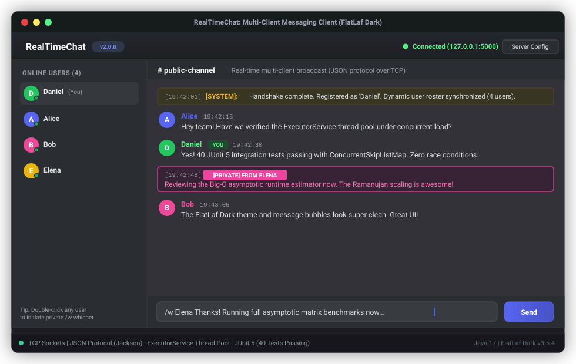

<p align="right">
  <strong>Idioma:</strong>
  <a href="README.md">English</a> | <b>Español</b>
</p>

# RealTimeChat NextGen v4.0

<p align="center">
  
  
  
  
  
  
  
  
  
</p>

**RealTimeChat NextGen v4.0** es una plataforma de colaboración y mensajería instantánea en tiempo real de alta concurrencia desarrollada en **Java 21 LTS** (Virtual Threads, GUI FlatLaf Dark, base de datos embebida H2 SQL, servidor HTTP de Webhooks y sockets TCP JSON). Incorpora arquitectura estilo Discord con Optimistic UI, hilos, reacciones en vivo, presencia avanzada, paginación por cursores, cola offline y resincronización, permisos bitfield RBAC, Markdown enriquecido con ejecución en Piston, comandos `/`, buscador con modificadores, pegado de imágenes `Ctrl+V`, vistas previas OpenGraph, salas de voz PCM, pizarra colaborativa y mensajes directos cifrados de extremo a extremo (ECDH + AES-256-GCM).

<p align="center">
  
</p>

---

## Características Implementadas

### Fase 1: Experiencia en Tiempo Real, Presencia y Personalización
- **Avatar Subible con Recorte y Redimensionado**: Carga imágenes locales PNG/JPG/GIF/WebP, recorta y ajusta zoom o desplazamiento desde `AvatarCropDialog`, y visualiza avatares circulares en mensajes del chat, barra lateral de miembros y tarjetas de perfil.
- **Editor de Perfil Mejorado**: Campo de biografía multilínea ampliado con límite estricto de `240` caracteres y contador en vivo (`0/240`), avatares vectoriales y banners personalizables.
- **Optimistic UI & Ciclo de Vida**: Inserción inmediata con `tempId` en estado `SENDING` (menor opacidad), confirmación `MESSAGE_ACK` con `id` y `timestamp` de BD, y tarjetas rojas `ERROR` con botones de "Reintentar" o "Eliminar" tras 8s sin respuesta.
- **Indicadores de Escritura con Throttle**: Emisión `TYPING_START` limitada a 1 cada 2.5s y debounce receptor de 3.0s cancelado al llegar el mensaje.
- **Respuestas Anidadas e Hilos Laterales**: Previsualización clicable del mensaje padre (`replyToId`) con scroll al original y panel lateral de hilo (`ThreadSidePanel`).
- **Sistema Avanzado de Presencia**: Detección automática de inactividad (`IDLE`), modo `DND` (silencia alertas sonoras), `OFFLINE` y texto de estado personalizado.
- **Reacciones Delta en Tiempo Real**: Eventos incrementales `REACTION_ADD` y `REACTION_REMOVE` agrupando contadores y usuarios por emoji.

### Fase 2: Escalabilidad, Resiliencia y Permisos RBAC
- **Persistencia H2 SQL**: Tablas persistentes `user_profiles`, `channels`, `messages` y `webhooks` en `./data/realtimechat`.
- **Paginación por Cursores (`beforeId` / `afterId`) y Virtualización**: Carga incremental hacia arriba sin `OFFSET` manteniendo la posición del scroll y podando tarjetas antiguas en memoria.
- **Cola Offline FIFO y Resincronización**: Reconexión automática con backoff, encolado local de mensajes sin red y petición `afterId` para recuperar mensajes perdidos al volver.
- **Gestión de Canales y Permisos Bitfield**: Alta y borrado de canales de texto/voz y motor de máscaras de bits (`VIEW_CHANNEL`, `SEND_MESSAGES`, `MANAGE_MESSAGES`, `ADMINISTRATOR`, `MANAGE_CHANNELS`, `MANAGE_ROLES`, `MANAGE_WEBHOOKS`, `CREATE_THREADS`, `VOICE_CONNECT`) con overrides por canal en servidor y UI.

### Fase 3: Herramientas Técnicas, Comandos y Búsqueda
- **Markdown Enriquecido y Ejecución Piston**: Soporta negrita, cursiva, tachado, código en línea, menciones `@usuario`, enlaces automáticos y bloques de código con botón Copiar y ejecución remota `▶ Run` contra Piston API (`stdout`/`stderr`).
- **Motor de Comandos `/` con Autocompletado**: Menú emergente interactivo con `/poll Pregunta | Op1 | Op2` (encuestas en vivo), `/roll`, `/shrug`, `/clear`, `/join`, `/createchannel`, `/deletechannel`, `/search`, `/status`, `/w`, `/bio` y `/whiteboard`.
- **Webhooks REST (`POST /api/webhooks/{id}/{token}`)**: Servidor HTTP integrado (`puertoTCP + 1`, por defecto `5001`) para publicar embeds externos en cualquier canal y endpoint `/api/health`.
- **Buscador Avanzado**: Modificadores `from:usuario`, `in:canal`, `has:link`, `has:file` y texto libre con salto directo al mensaje seleccionado.

### Fase 4: Multimedia, Colaboración y Seguridad
- **Pegado Directo de Imágenes (`Ctrl+V`)**: Intercepta imágenes del portapapeles, previsualiza tiras adjuntas, redimensiona/comprime con `ImageUtils` y abre visor lightbox al pulsar sobre la imagen enviada.
- **Previsualizaciones OpenGraph Asíncronas**: Extracción en segundo plano (`og:title`, `og:description`, `og:image`, `og:site_name`) con protección SSRF y emisión `MESSAGE_EMBED_UPDATE`.
- **Salas de Voz PCM y Pizarra Colaborativa**: Audio 16 kHz mono (`javax.sound.sampled`) con medidores RMS, Mute/Deafen, señalización `WEBRTC_SIGNAL` y pizarra en tiempo real (`WhiteboardDialog`).
- **Cifrado de Extremo a Extremo (E2EE) en DMs**: Intercambio de claves **ECDH (`secp256r1`)** y cifrado **AES-256-GCM** por pareja de usuarios; el servidor y la base de datos H2 solo almacenan el ciphertext y el `iv`.

---

## Compilación y Ejecución

```bash
# Compilar, ejecutar los 103 tests JUnit 5 y empaquetar Fat JAR
mvn clean test package

# Iniciar Servidor (TCP :5000 + Webhooks HTTP :5001)
java -cp target/realtimechat-1.0.0.jar com.danicaju.chat.server.ChatServer 5000

# Iniciar Cliente Gráfico (GUI)
java -jar target/realtimechat-1.0.0.jar

# Iniciar Cliente de Consola (CLI)
java -cp target/realtimechat-1.0.0.jar com.danicaju.chat.client.ChatConsoleClient
```

---

## Calidad y Pruebas Automatizadas

Ejecución verificada con **103 pruebas automatizadas en JUnit 5** repartidas en 15 suites (`Failures: 0, Errors: 0, Skipped: 0`):
`ChatRoomTest` (32), `MessageTest` (16), `RealTimeBotTest` (14), `ChatServerIntegrationTest` (11), `DatabaseManagerTest` (5), `PhaseOneToFourIntegrationTest` (4), `TokenBucketRateLimiterTest` (4), `UserProfileTest` (4), `SlashCommandHelperTest` (3), `ImageUtilsAndMarkdownTest` (2), `OpenGraphServiceTest` (2), `E2EECryptoTest` (2), `PermissionTest` (2), `PistonClientTest` (1) y `SearchQueryParserTest` (1).

---

<p align="center">
  <sub>Desarrollado por <b>Daniel Casado Juan</b> | Universitat de les Illes Balears (UIB)</sub>
</p>
