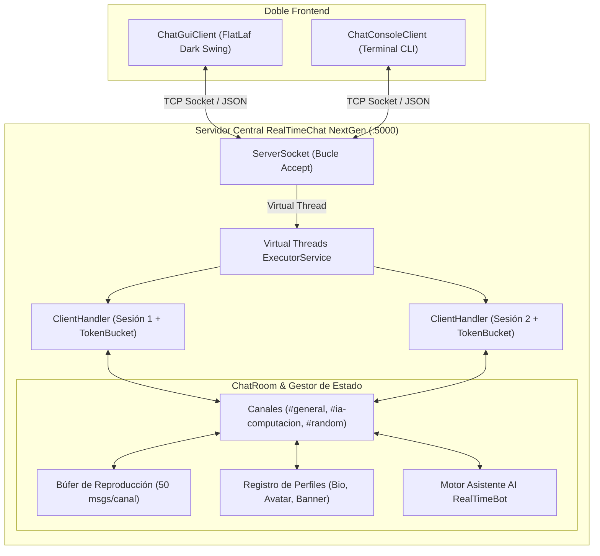

<p align="right">
  <strong>Idioma:</strong>
  <a href="README.md">English</a> | <b>Español</b>
</p>

# RealTimeChat NextGen

<p align="center">
  
  
  
  
  
  
  
  
  
</p>

**RealTimeChat NextGen** es una plataforma moderna de colaboración y mensajería instantánea en tiempo real de alta concurrencia desarrollada en **Java 21 LTS** sobre sockets TCP/IP. Incorpora arquitectura multicanal, búfer de reproducción (historial reciente), indicadores de escritura en tiempo real (typing indicator), personalización integral de perfiles de usuario (avatar, biografía y banner), control de saturación y spam mediante Token Bucket, asistente inteligente de computación integrado (**RealTimeBot**) y despliegue en contenedores Docker.

<p align="center">
  
</p>

---

## Características Principales

1. **Alta Concurrencia y Virtual Threads (Project Loom)**:
   - Procesamiento de I/O de alto rendimiento mediante **Virtual Threads** de Java 21 (`Executors.newVirtualThreadPerTaskExecutor()`) con fallback automático a pools tradicionales en caso de ser necesario.
   - Consumo mínimo de memoria por conexión (~1 KB frente a ~1 MB en hilos de sistema operativo tradicionales), soportando miles de clientes concurrentes.

2. **Protección Anti-Spam (Rate Limiter Token Bucket)**:
   - Algoritmo atómico de Token Bucket por cliente que previene ataques de saturación y flooding de mensajes, permitiendo ráfagas cortas e interactivas.

3. **Arquitectura Multicanal (#general, #ia-computacion, #random)**:
   - Salas y canales de texto independientes con cambio dinámico de canal, lista de usuarios por canal y aislamiento de mensajes.

4. **Búfer de Reproducción de Mensajes (Historial Reciente)**:
   - Búfer circular en servidor (últimos 50 mensajes por canal) que se entrega automáticamente al unirse o cambiar de canal.

5. **Indicador de Escritura en Tiempo Real (Typing Indicator)**:
   - Eventos reactivos `TYPING_START` y `TYPING_STOP` con debounce automático que notifican visualmente en la interfaz quién está escribiendo.

6. **Personalización Completa de Perfil de Usuario**:
   - Soporte para biografía (hasta 300 caracteres), selector de avatares vectoriales predefinidos (`cyber-neon`, `synthwave`, `cosmic`, `emerald`, `sunset`, `bot-matrix`, `golden`, `retro-pixel`) y banners personalizables con colores o degradados.
   - Editor de perfil integrado y tarjeta emergente de inspección al pulsar sobre cualquier usuario.

7. **Asistente Inteligente AI Integrado (RealTimeBot)**:
   - Bot virtual interactivo invocable en cualquier canal mediante `@bot` o `@ai`.
   - Funcionalidades:
     - Resumen del canal: `@bot resume` sintetiza los puntos clave de la conversación reciente.
     - Calculadora matemática: `@bot calc <expresion>` (ej: `@bot calc 2^10 + 50`, `@bot calc sqrt(144)`).
     - Diagnóstico del servidor: `@bot info` (memoria JVM, núcleos CPU, hilos virtuales).
     - Conocimiento computacional: Explicaciones sobre concurrencia, hilos virtuales, deadlocks, TCP vs UDP, complejidad Big-O y Jackson.

8. **Doble Frontend**:
   - **Interfaz Gráfica de Escritorio (GUI)**: Diseño oscuro contemporáneo inspirado en Slack/Discord con **FlatLaf Dark**, selector de canales, renderizado enriquecido e indicadores vectoriales.
   - **Cliente de Terminal (CLI)**: Consola ágil con comandos de barra inclinada (`/join`, `/channels`, `/bio`, `/avatar`, `/profile`, `/w`, `/help`).

9. **Empaquetado y DevOps (Docker)**:
   - `Dockerfile` multi-etapa con imagen ligera Alpine JRE 21 lista para producción.

---

## Arquitectura de Red



---

## Especificación del Protocolo JSON

Todas las tramas intercambiadas utilizan codificación UTF-8 en formato JSON estándar serializadas mediante Jackson Databind.

### Campos de las Tramas

| Campo | Tipo | Descripción |
| :--- | :---: | :--- |
| `type` | `String` | Tipo de trama (`JOIN`, `CHAT`, `PRIVATE`, `USER_LIST`, `LEAVE`, `SYSTEM`, `JOIN_CHANNEL`, `CHANNEL_LIST`, `HISTORY`, `TYPING_START`, `TYPING_STOP`, `PROFILE_UPDATE`, `PROFILE_REQUEST`, `PROFILE_RESPONSE`). |
| `sender` | `String` | Remitente del mensaje, `SYSTEM` o `RealTimeBot`. |
| `target` | `String` | Destinatario en mensajes privados o consulta de perfiles. |
| `channel` | `String` | Identificador del canal activo (ej: `#general`, `#ia-computacion`). |
| `content` | `String` | Cuerpo de texto del mensaje o aviso informativo. |
| `users` | `List<String>` | Lista de usuarios activos en el canal. |
| `channels` | `List<String>` | Lista de canales disponibles en el servidor. |
| `history` | `List<Message>` | Búfer de mensajes reproducidos al cambiar de canal. |
| `profile` | `UserProfile` | Metadatos de perfil (username, bio, avatar, banner). |
| `timestamp` | `long` | Marca temporal Unix epoch en milisegundos. |

### Ejemplos de Protocolo

```json
// 1. Cambio de Canal
{
  "type": "JOIN_CHANNEL",
  "sender": "alice",
  "channel": "#ia-computacion",
  "timestamp": 1731175200000
}

// 2. Notificación de Escritura (Typing Start)
{
  "type": "TYPING_START",
  "sender": "alice",
  "channel": "#general",
  "timestamp": 1731175205000
}

// 3. Actualización de Perfil Personal
{
  "type": "PROFILE_UPDATE",
  "sender": "alice",
  "profile": {
    "username": "alice",
    "bio": "Arquitecta de Software Cloud y Sistemas Distribuidos",
    "avatar": "synthwave",
    "banner": "gradient-cyber"
  },
  "timestamp": 1731175210000
}

// 4. Consulta al Asistente Inteligente
{
  "type": "CHAT",
  "sender": "alice",
  "channel": "#ia-computacion",
  "content": "@bot calc 2^10",
  "timestamp": 1731175215000
}
```

---

## Comandos Disponibles

### Interfaz Gráfica (GUI)
- Doble clic sobre cualquier usuario en la lista lateral para ver su **Tarjeta de Perfil** o preparar un susurro privado.
- Botón **"Mi Perfil"** en la barra superior para editar biografía, presets de avatar y estilos de banner con previsualización en vivo.
- Clic en cualquier canal en **CANALES DE TEXTO** para cambiar de sala y cargar su historial de reproducción.
- En la caja de texto: escribe `@bot resume`, `@bot calc 2^10`, `/w <usuario> <mensaje>`, o `/join <#canal>`.

### Terminal (CLI)
| Comando | Acción |
| :--- | :--- |
| `/join <#canal>` | Cambiar de canal de texto |
| `/channels` | Listar canales disponibles en el servidor |
| `/w <usuario> <msg>` | Enviar mensaje privado directo |
| `/bio <texto>` | Actualizar biografía personal |
| `/avatar <preset>` | Cambiar avatar (`cyber-neon`, `synthwave`, `cosmic`, etc.) |
| `/banner <preset/#hex>` | Personalizar estilo de banner o color hexadecimal |
| `/profile <usuario>` | Consultar la tarjeta de perfil de un usuario |
| `@bot <pregunta>` | Consultar al asistente virtual AI |
| `/list` | Listar usuarios conectados en el canal actual |
| `/help` | Mostrar guía de comandos |
| `/quit` | Desconexión controlada |

---

## Compilación y Ejecución

### Requisitos Previos
- **Java Development Kit (JDK) 21 LTS+**
- **Apache Maven 3.8+**
- *(Opcional)* **Docker**

### Compilar y Ejecutar Pruebas
```bash
mvn clean test
```

### Ejecutar Servidor Central (Puerto por defecto: 5000)
```bash
mvn exec:java@server
```
*Puerto personalizado:*
```bash
mvn exec:java@server -Dexec.args="8080"
```

### Ejecutar Cliente Gráfico (GUI)
```bash
mvn exec:java@gui
```

### Ejecutar Cliente de Terminal (CLI)
```bash
mvn exec:java@cli
```

### Empaquetar JAR Ejecutable (Fat JAR)
```bash
mvn clean package -DskipTests
```
Genera el artefacto sombreado en `target/realtimechat-1.0.0.jar`.

---

## Despliegue con Docker

Construcción y ejecución del servidor mediante el `Dockerfile` multi-etapa incluido:

```bash
# Construir imagen Docker
docker build -t realtimechat:latest .

# Iniciar contenedor en el puerto 5000
docker run -d --name realtimechat-server -p 5000:5000 realtimechat:latest
```

---

## Calidad y Batería de Pruebas

El repositorio cuenta con **81 pruebas automatizadas con JUnit 5** en 5 suites especializadas:
- **`RealTimeBotTest` (14 pruebas)**: Detección de comandos de bot, resumen de historial, parseo y evaluación matemática (`^`, `sqrt`, precedencia aritmética, división por cero) y respuestas conceptuales.
- **`ChatServerIntegrationTest` (11 pruebas)**: Pruebas end-to-end sobre sockets de red TCP reales que validan handshake, múltiples canales, búfer de reproducción, eventos de escritura (typing), perfiles de usuario, difusión reactiva de perfiles, aislamiento estricto de notificaciones entre canales, mitigación de flooding con Rate Limiter y respuestas de RealTimeBot.
- **`MessageTest` (16 pruebas)**: Serialización/deserialización JSON, compatibilidad hacia adelante, tolerancia a campos desconocidos y métodos factoría (incluyendo mensajes de sistema asociados a canal).
- **`UserProfileTest` (4 pruebas)**: Valores por defecto, saneamiento y límite de longitud de biografía, serialización JSON e igualdad.
- **`ChatRoomTest` (32 pruebas)**: Concurrencia atómica, mitigación de colisiones insensible a mayúsculas, validación de nombres de canal, cambio de canal, búfer de historial y perfiles.
- **`TokenBucketRateLimiterTest` (4 pruebas)**: Capacidad de ráfaga, cálculo de recarga en el tiempo, validación de parámetros y estrés multihilo.

```text
[INFO] Results:
[INFO] Tests run: 81, Failures: 0, Errors: 0, Skipped: 0
[INFO] BUILD SUCCESS
```

---

<p align="center">
  <sub>Desarrollado por <b>Daniel Casado Juan</b> | Universitat de les Illes Balears (UIB)</sub>
</p>
