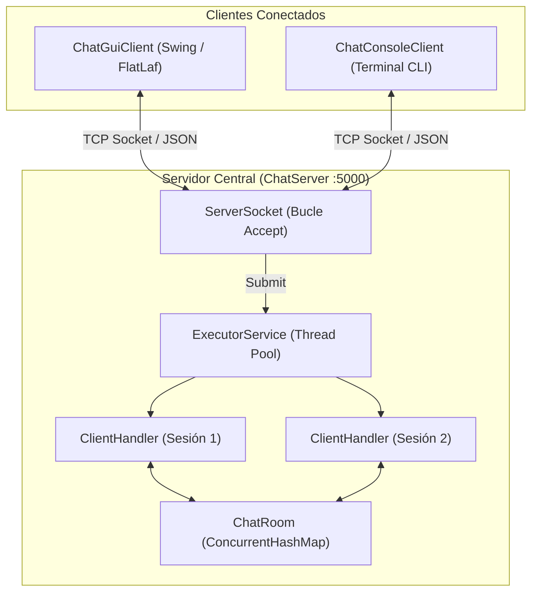

# RealTimeChat

<p align="center">
  
  
  
  
  
</p>

Plataforma cliente-servidor de mensajería instantánea en tiempo real desarrollada en **Java 17+** sobre sockets TCP/IP. Incorpora un protocolo estructurado en **JSON**, gestión de concurrencia mediante **Thread Pool (ExecutorService)**, control atómico de usuarios y **doble frontend**: una interfaz gráfica moderna inspirada en Discord/Slack con Look & Feel **FlatLaf Dark** y un cliente de terminal interactivo ágil y eficiente.

---

## Arquitectura de Red

El servidor central coordina las sesiones activas distribuyendo la carga de I/O en un grupo de hilos reutilizables, manteniendo la sincronización atómica de los usuarios registrados y difundiendo eventos tanto públicos como privados.



---

## Especificación del Protocolo JSON

Todas las tramas intercambiadas entre clientes y servidor utilizan codificación UTF-8 en formato JSON estándar, procesadas a través de Jackson Databind.

### Estructura General del Mensaje

| Campo | Tipo | Requerido | Descripción |
|---|---|---|---|
| `type` | String | Sí | Tipo de acción: `JOIN`, `CHAT`, `PRIVATE`, `USER_LIST`, `LEAVE`, `SYSTEM`. |
| `sender` | String | Opcional | Nombre del usuario que emite el mensaje o solicita la acción. |
| `target` | String | Opcional | Destinatario del mensaje (obligatorio en `PRIVATE`). |
| `content` | String | Opcional | Carga de texto del mensaje, aviso o descripción del error. |
| `users` | Array[String] | Opcional | Lista de nombres de usuario en notificaciones `USER_LIST`. |
| `timestamp` | Long | Sí | Marca temporal en milisegundos Unix epoch. |

### Tipos de Mensajes

#### 1. `JOIN` (Handshake y Registro de Usuario)
Solicitud enviada por el cliente al establecer conexión. El servidor valida la disponibilidad y formato del nickname.

```json
{
  "type": "JOIN",
  "sender": "alice",
  "timestamp": 1714500000000
}
```

* **Respuesta de Éxito:** `{"type": "SYSTEM", "content": "OK: Conectado correctamente como alice", ...}`
* **Respuesta de Error:** `{"type": "SYSTEM", "content": "ERROR: El nombre de usuario 'alice' ya está en uso...", ...}`

#### 2. `CHAT` (Mensaje Público)
Mensaje emitido a la sala común recibido por todos los clientes conectados.

```json
{
  "type": "CHAT",
  "sender": "alice",
  "content": "¡Hola a todos en la sala!",
  "timestamp": 1714500010000
}
```

#### 3. `PRIVATE` (Mensaje Directo)
Comunicación confidencial punto a punto mediante comando `/w <usuario> <mensaje>`. Si el destinatario no existe, el servidor devuelve un `SYSTEM` de error al emisor.

```json
{
  "type": "PRIVATE",
  "sender": "alice",
  "target": "bob",
  "content": "¿Revisaste el informe de rendimiento?",
  "timestamp": 1714500020000
}
```

#### 4. `USER_LIST` (Actualización Reactiva de Usuarios)
Difusión periódica o tras cada alta/baja de usuario que sincroniza el panel lateral en la GUI y el comando `/list` en la CLI.

```json
{
  "type": "USER_LIST",
  "users": ["alice", "bob", "charlie"],
  "timestamp": 1714500025000
}
```

#### 5. `LEAVE` (Desconexión Controlada)
Notificación enviada antes del cierre voluntario de sesión.

```json
{
  "type": "LEAVE",
  "sender": "bob",
  "timestamp": 1714500030000
}
```

#### 6. `SYSTEM` (Avisos del Servidor)
Notificaciones sobre el ciclo de vida de la sala, conexiones, desconexiones o alertas del sistema.

```json
{
  "type": "SYSTEM",
  "content": "🟢 bob se ha unido a la sala.",
  "timestamp": 1714500005000
}
```

---

## Características Principales

* **Gestión Concurrente Eficiente:** Uso de `ExecutorService` (Thread Pool) en lugar de crear un hilo sin control por conexión, evitando el agotamiento de memoria del sistema operativo.
* **Almacenamiento Atómico:** `ConcurrentHashMap` con operaciones atómicas (`putIfAbsent`, `remove`) para garantizar la unicidad de apodos e impedir condiciones de carrera.
* **Apagado Limpio (Shutdown Hook):** `Runtime.getRuntime().addShutdownHook` asegura que los puertos del servidor y los flujos de red se cierren ordenadamente al detener el proceso.
* **Cliente Gráfico FlatLaf Dark:** Interfaz Swing de estética moderna con:
  * Barra superior con indicador reactivo del estado de conexión y badge de nickname.
  * Panel lateral dinámico con lista de usuarios conectados, avatars y badges de presencia.
  * Área de chat con renderizado HTML, marcas de tiempo `[HH:mm:ss]`, colores temáticos para mensajes directos y mensajes de sistema.
  * Acceso directo de mensaje privado haciendo doble clic en cualquier usuario de la lista.
  * Diálogo modal de conexión con validación integrada contra apodos repetidos.
* **Cliente de Consola CLI:** Interfaz por línea de comandos ligera con ayuda integrada (`/help`), mensajes privados (`/w`) y refresco de miembros activos (`/list`).
* **Batería de Pruebas Automatizadas:** 31 pruebas unitarias y de integración en JUnit 5 que validan serialización JSON, reglas de negocio de la sala de chat y flujo de red end-to-end con sockets efímeros reales.

---

## Estructura del Proyecto

```text
RealTimeChat/
├── pom.xml                                    # Configuración Maven, dependencias y plugin Shade
├── README.md                                  # Documentación técnica del proyecto
├── LICENSE                                    # Licencia MIT
└── src/
    ├── main/java/com/danicaju/chat/
    │   ├── model/
    │   │   ├── Message.java                   # Modelo de mensaje y serialización Jackson
    │   │   └── MessageType.java               # Tipos de tramas del protocolo
    │   ├── server/
    │   │   ├── ChatServer.java                # Servidor con Thread Pool y ServerSocket
    │   │   ├── ChatRoom.java                  # Gestor concurrente de usuarios y enrutamiento
    │   │   └── ClientHandler.java             # Procesador de cliente (Runnable)
    │   └── client/
    │       ├── ChatClientConnection.java      # Motor cliente TCP reutilizable
    │       ├── ChatEventListener.java         # Interfaz de eventos reactivos
    │       ├── ChatConsoleClient.java         # Cliente de terminal interactivo
    │       └── ChatGuiClient.java             # Cliente de escritorio Swing FlatLaf Dark
    └── test/java/com/danicaju/chat/
        ├── ChatServerIntegrationTest.java     # Test E2E de comunicación cliente-servidor
        ├── model/
        │   └── MessageTest.java               # Tests unitarios del protocolo JSON
        └── server/
            └── ChatRoomTest.java              # Tests unitarios de gestión concurrente
```

---

## Compilación y Ejecución

### Requisitos Previos

* **Java Development Kit (JDK):** Versión 17 o superior.
* **Apache Maven:** Versión 3.8 o superior.

### 1. Compilar y Ejecutar Pruebas Automatizadas

```bash
mvn clean test
```

### 2. Generar el Paquete JAR Ejecutable

```bash
mvn clean package
```

El artefacto generado se ubicará en `target/realtimechat-1.0.0.jar` conteniendo todas las dependencias necesarias empaquetadas (Uber-JAR).

### 3. Iniciar el Servidor

```bash
# Por defecto se iniciará en el puerto 5000
java -cp target/realtimechat-1.0.0.jar com.danicaju.chat.server.ChatServer

# O indicando un puerto específico
java -cp target/realtimechat-1.0.0.jar com.danicaju.chat.server.ChatServer 8080
```

### 4. Iniciar el Cliente de Escritorio (GUI FlatLaf)

```bash
# Ejecutar directamente el JAR principal (configurado por defecto en el Manifest)
java -jar target/realtimechat-1.0.0.jar

# O especificando la clase principal
java -cp target/realtimechat-1.0.0.jar com.danicaju.chat.client.ChatGuiClient
```

### 5. Iniciar el Cliente de Consola (CLI)

```bash
java -cp target/realtimechat-1.0.0.jar com.danicaju.chat.client.ChatConsoleClient
```

---

## Comandos del Cliente

Tanto desde la consola como desde la barra de texto de la interfaz gráfica están disponibles los siguientes comandos:

| Comando | Parámetros | Descripción |
|---|---|---|
| `/w` o `/msg` | `<usuario> <mensaje>` | Envía un mensaje privado exclusivo al destinatario indicado. |
| `/list` o `/usuarios` | *(ninguno)* | Solicita al servidor y muestra la lista de usuarios conectados. |
| `/help` o `/ayuda` | *(ninguno)* | Muestra la guía rápida de comandos disponibles. |
| `/quit` o `/salir` | *(ninguno)* | Envía la trama `LEAVE` y cierra la conexión ordenadamente. |

---

## Licencia

Este proyecto está bajo la Licencia [MIT](LICENSE).
