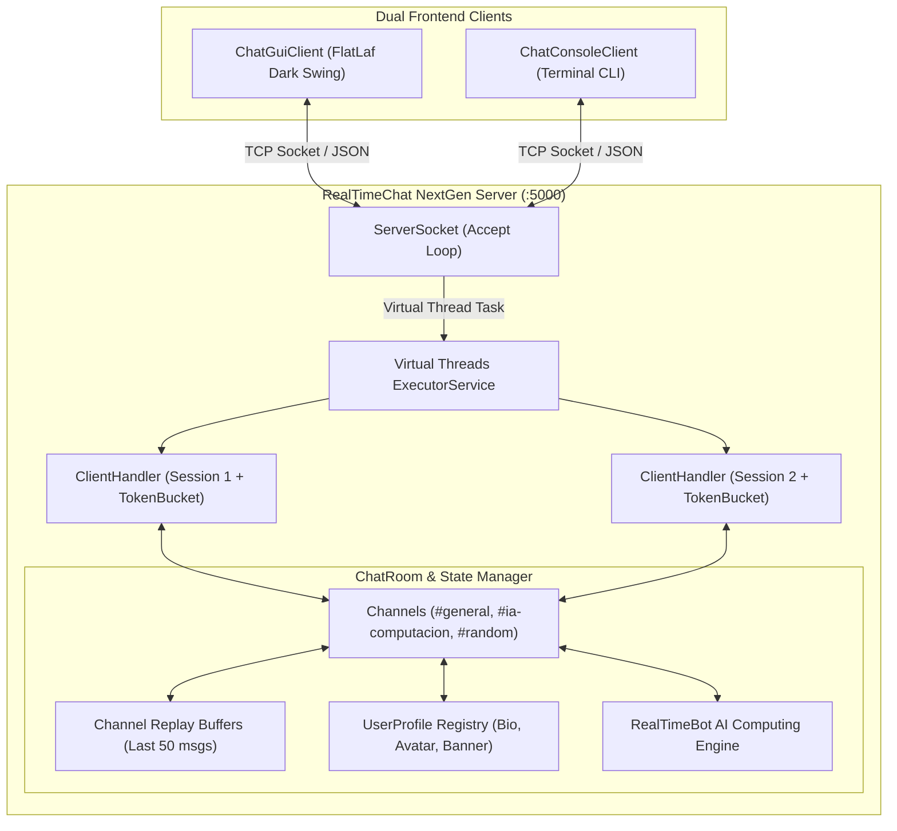

<p align="right">
  <strong>Language:</strong>
  <b>English</b> | <a href="README.es.md">Español</a>
</p>

# RealTimeChat NextGen

<p align="center">
  
  
  
  
  
  
  
  
  
</p>

**RealTimeChat NextGen** is a modern, high-concurrency real-time collaboration and instant messaging platform built in **Java 21 LTS** over raw TCP/IP sockets. It features a complete multi-channel room architecture, message replay buffer (history), real-time typing indicators, user profile customization (avatar, bio, and banner styles), token bucket rate limiting against flooding, an embedded intelligent computing assistant (**RealTimeBot**), and containerized deployment via Docker.

<p align="center">
  
</p>

---

## Key Features

1. **High Concurrency & Virtual Threads (Project Loom)**:
   - High-throughput I/O powered by Java 21 **Virtual Threads** (`Executors.newVirtualThreadPerTaskExecutor()`) with transparent fallback to cached thread pools.
   - Low memory overhead per connection (~1 KB vs ~1 MB of traditional OS platform threads), allowing thousands of concurrent client sessions.

2. **DoS & Flood Defense (Token Bucket Rate Limiter)**:
   - Atomic per-client Token Bucket algorithm limiting abusive flooding and message spam while seamlessly allowing natural interactive bursts.

3. **Multi-Channel Architecture**:
   - Independent text channels (`#general`, `#ia-computacion`, `#random`) with dynamic channel switching, per-channel user rosters, and isolated message distribution.

4. **Message Replay Buffer (History Delivery)**:
   - Server-side circular buffer (last 50 messages per channel) replayed to clients upon joining or switching channels.

5. **Real-Time Typing Indicator**:
   - Reactive `TYPING_START` and `TYPING_STOP` protocol events notifying users when peers are typing in the current channel, with automatic debouncing.

6. **Customizable User Profiles**:
   - Profile metadata support: Biography (up to 300 characters), vector avatar presets (`cyber-neon`, `synthwave`, `cosmic`, `emerald`, `sunset`, `bot-matrix`, `golden`, `retro-pixel`), and customizable banners (colors and gradients).
   - In-app profile editor and profile card modal dialogs.

7. **Embedded AI Computing Assistant (RealTimeBot)**:
   - Virtual assistant invoked in any channel via `@bot` or `@ai`.
   - Capabilities:
     - Channel summary: `@bot resume` summarizes recent conversation points.
     - Mathematical calculator: `@bot calc <expression>` (e.g., `@bot calc 2^10 + 50`, `@bot calc sqrt(144)`).
     - System diagnostics: `@bot info` (runtime memory, CPUs, virtual threads).
     - Interactive explanations: Concurrency, deadlocks, TCP vs UDP, Big-O algorithmic complexity, Jackson serialization.

8. **Dual Frontends**:
   - **Modern Desktop GUI**: Discord/Slack-inspired dark theme powered by **FlatLaf Dark**, responsive layout, vector indicators, and popup menus.
   - **Interactive CLI Client**: Agile terminal interface with slash commands (`/join`, `/channels`, `/bio`, `/avatar`, `/profile`, `/w`, `/help`).

9. **Containerization & DevOps**:
   - Multi-stage `Dockerfile` with JRE 21 Alpine base image for lightweight container deployment.

---

## Network Architecture



---

## JSON Protocol Specification

All frames exchanged utilize UTF-8 JSON payloads serialized through Jackson Databind and JavaTimeModule.

### Frame Fields

| Field | Type | Description |
| :--- | :---: | :--- |
| `type` | `String` | Protocol message type (`JOIN`, `CHAT`, `PRIVATE`, `USER_LIST`, `LEAVE`, `SYSTEM`, `JOIN_CHANNEL`, `CHANNEL_LIST`, `HISTORY`, `TYPING_START`, `TYPING_STOP`, `PROFILE_UPDATE`, `PROFILE_REQUEST`, `PROFILE_RESPONSE`). |
| `sender` | `String` | Alias of the origin user, `SYSTEM`, or `RealTimeBot`. |
| `target` | `String` | Target user for private messages or profile queries. |
| `channel` | `String` | Active channel identifier (e.g., `#general`, `#ia-computacion`). |
| `content` | `String` | Message text or system notification payload. |
| `users` | `List<String>` | Active roster payload for the channel. |
| `channels` | `List<String>` | Available channels roster. |
| `history` | `List<Message>` | Replay buffer delivered when entering a channel. |
| `profile` | `UserProfile` | Profile metadata (username, bio, avatar, banner). |
| `timestamp` | `long` | Unix epoch millisecond timestamp. |

### Protocol Examples

```json
// 1. Channel Switching
{
  "type": "JOIN_CHANNEL",
  "sender": "alice",
  "channel": "#ia-computacion",
  "timestamp": 1731175200000
}

// 2. Real-Time Typing Start
{
  "type": "TYPING_START",
  "sender": "alice",
  "channel": "#general",
  "timestamp": 1731175205000
}

// 3. User Profile Update
{
  "type": "PROFILE_UPDATE",
  "sender": "alice",
  "profile": {
    "username": "alice",
    "bio": "Cloud and Distributed Systems Specialist",
    "avatar": "synthwave",
    "banner": "gradient-cyber"
  },
  "timestamp": 1731175210000
}

// 4. AI Assistant Query
{
  "type": "CHAT",
  "sender": "alice",
  "channel": "#ia-computacion",
  "content": "@bot calc 2^10",
  "timestamp": 1731175215000
}
```

---

## Available Commands

### Desktop GUI
- Double-click any user in the sidebar to open their **Profile Card** or start a whisper.
- Click **"Mi Perfil"** in the top bar to edit bio, avatar presets, and banner styles with live preview.
- Click any channel in **CANALES DE TEXTO** to switch room and load its replay buffer.
- In input field: type `@bot resume`, `@bot calc 2^10`, `/w <user> <message>`, or `/join <#channel>`.

### Terminal CLI
| Command | Action |
| :--- | :--- |
| `/join <#channel>` | Switch active chat channel |
| `/channels` | List all available channels on the server |
| `/w <user> <msg>` | Send private direct message |
| `/bio <text>` | Update personal biography |
| `/avatar <preset>` | Choose avatar preset (`cyber-neon`, `synthwave`, `cosmic`, etc.) |
| `/banner <preset/#hex>` | Customize personal banner style or hex color |
| `/profile <user>` | Inspect user profile card |
| `@bot <question>` | Ask the embedded AI assistant |
| `/list` | List users connected in current channel |
| `/help` | Display command guide |
| `/quit` | Cleanly disconnect |

---

## Build & Execution

### Prerequisites
- **Java Development Kit (JDK) 21 LTS+**
- **Apache Maven 3.8+**
- *(Optional)* **Docker**

### Compile & Run Tests
```bash
mvn clean test
```

### Run Server (Default Port: 5000)
```bash
mvn exec:java@server
```
*Custom port:*
```bash
mvn exec:java@server -Dexec.args="8080"
```

### Launch Desktop GUI Client
```bash
mvn exec:java@gui
```

### Launch Terminal CLI Client
```bash
mvn exec:java@cli
```

### Package Standalone Fat JAR
```bash
mvn clean package -DskipTests
```
Generates shaded executable JAR at `target/realtimechat-1.0.0.jar`.

---

## Docker Deployment

Build and run the containerized server using the included multi-stage Dockerfile:

```bash
# Build Docker image
docker build -t realtimechat:latest .

# Run container on port 5000
docker run -d --name realtimechat-server -p 5000:5000 realtimechat:latest
```

---

## Testing & Quality Assurance

The test suite contains **81 automated JUnit 5 tests** across 5 focused test suites:
- **`RealTimeBotTest` (14 tests)**: Verification of bot queries, summarization, mathematical parsing (`^`, `sqrt`, arithmetic precedence, division by zero), and technical concepts.
- **`ChatServerIntegrationTest` (11 tests)**: End-to-end integration over real TCP network sockets covering handshake, channels, history replay, real-time typing indicators, user profiles, reactive profile broadcasting, channel notification isolation, rate limit throttling, and bot responses.
- **`MessageTest` (16 tests)**: Protocol serialization, forward compatibility, unknown fields tolerance, and message factory methods (including channel-scoped system messages).
- **`UserProfileTest` (4 tests)**: Profile defaults, bio sanitization & length limits, JSON serialization, and equality.
- **`ChatRoomTest` (32 tests)**: Atomic concurrency, case-insensitive collision defense, channel name validation, channel switching, replay buffers, and profile storage.
- **`TokenBucketRateLimiterTest` (4 tests)**: Burst capacity, token replenishment timing, parameter validation, and multi-threaded stress tests.

```text
[INFO] Results:
[INFO] Tests run: 81, Failures: 0, Errors: 0, Skipped: 0
[INFO] BUILD SUCCESS
```

---

<p align="center">
  <sub>Developed by <b>Daniel Casado Juan</b> | Universitat de les Illes Balears (UIB)</sub>
</p>
