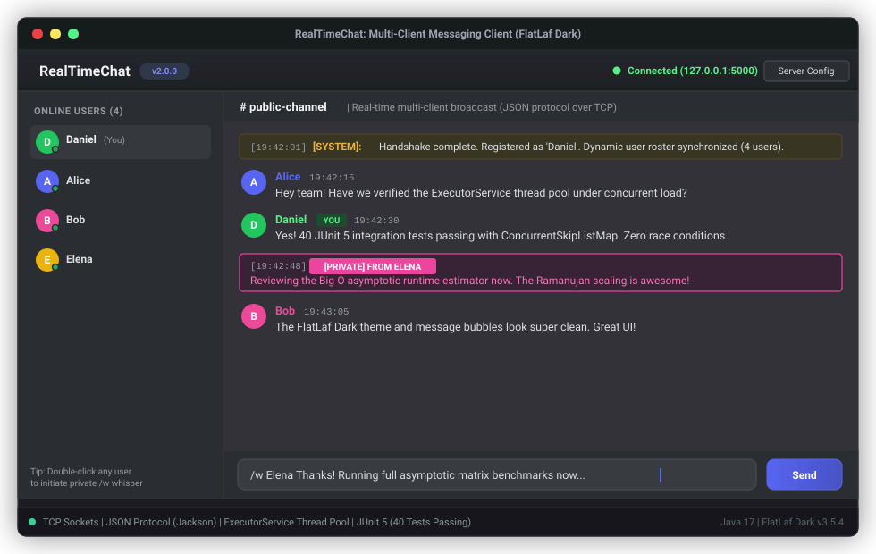
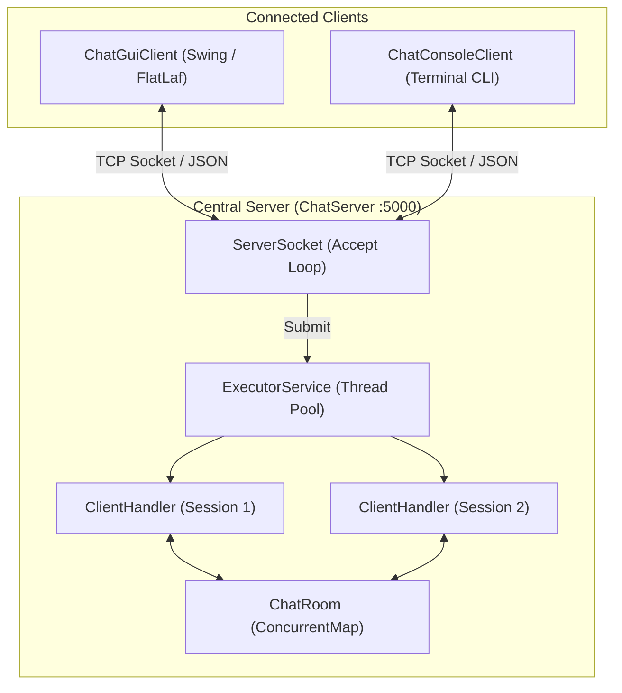

<p align="right">
  <strong>Language:</strong>
  <b>English</b> | <a href="README.es.md">Español</a>
</p>

# RealTimeChat

<p align="center">
  
  
  
  
  
</p>

A robust real-time client-server instant messaging platform engineered in **Java 17+** over raw TCP/IP sockets. Built with a structured **JSON application protocol**, scalable concurrency management via **`ExecutorService` (Thread Pool)**, atomic case-insensitive user registry, and **dual frontends**: a modern Slack/Discord-inspired GUI themed with **FlatLaf Dark** and an agile, interactive terminal client.

<p align="center">
  
</p>

---

## Network Architecture

The central server orchestrates active sessions by delegating socket I/O across a reusable thread pool, maintaining atomic synchronization over registered users, and broadcasting public channel events as well as point-to-point private messages.



---

## JSON Protocol Specification

All frames exchanged between clients and the server utilize standard UTF-8 JSON payloads processed via Jackson Databind.

### Message Structure

| Field | Type | Description |
| :--- | :---: | :--- |
| `type` | `String` | Message category (`CONNECT`, `MESSAGE`, `PRIVATE_MESSAGE`, `USER_LIST`, `DISCONNECT`, `ERROR`). |
| `sender` | `String` | Alias of the origin user or `SYSTEM`. |
| `recipient` | `String` | Destination alias (required for `PRIVATE_MESSAGE`; `null` for public broadcasts). |
| `content` | `String` | Text body of the message. |
| `timestamp` | `long` | Epoch timestamp in milliseconds. |
| `users` | `List<String>` | Active roster payload delivered with `USER_LIST`. |

### Protocol Flow Examples

```json
// 1. Connection Handshake
{
  "type": "CONNECT",
  "sender": "Daniel",
  "content": "Requested nickname registration",
  "timestamp": 1731175200000
}

// 2. Public Channel Broadcast
{
  "type": "MESSAGE",
  "sender": "Daniel",
  "content": "Hello team, real-time messaging is up and running!",
  "timestamp": 1731175215000
}

// 3. Private Direct Message (Whisper)
{
  "type": "PRIVATE_MESSAGE",
  "sender": "Daniel",
  "recipient": "Alice",
  "content": "Let's review the concurrency benchmarks.",
  "timestamp": 1731175230000
}

// 4. Dynamic User Roster Broadcast
{
  "type": "USER_LIST",
  "sender": "SYSTEM",
  "users": ["Alice", "Bob", "Daniel"],
  "timestamp": 1731175235000
}
```

---

## Engineering & Concurrency Highlights

- **Thread Pool Scalability**: The server decouples network connection acceptance from request execution using an `ExecutorService` cached/bounded thread pool, preventing thread-exhaustion denial-of-service vulnerabilities.
- **Atomic Case-Insensitive Nick Registry**: Active user handles are managed through `ConcurrentSkipListMap(String.CASE_INSENSITIVE_ORDER)`. Username availability verification and registration occur atomically (`putIfAbsent`), eliminating check-then-act race conditions where "Alice" and "alice" might conflict.
- **Graceful Lifecycle & Resource Safety**: Both client implementations (`ChatClientConnection`) and server handlers (`ClientHandler`) leverage `AtomicBoolean` flags and `AutoCloseable` wrappers to guarantee deterministic teardown of sockets, reader threads, and GUI event handlers.
- **Payload Sanitization & DoS Defense**: Input frames enforce strict length caps (maximum 10,000 characters) and sanitize HTML entities (`&`, `<`, `>`, `"`) prior to UI rendering to eliminate injection and malformed payload crashes.

---

## Dual Client Interfaces

### 1. Modern Desktop GUI (Swing + FlatLaf Dark)
- Modern dark appearance powered by **FlatLaf 3.5.4** (`FlatDarkLaf`).
- Structured three-pane layout: server status and channel header, scrollable chat panel with HTML-styled message cards, active user sidebar with online count badges, and dedicated message composer.
- Point-to-point private messaging via slash command `/w <user> <message>` or `/whisper <user> <message>`.
- Distinct color-coded bubbles: public messages in cool blue, private whispers in purple, and system events in amber.
- Full integration with the Swing Event Dispatch Thread (EDT) via `SwingUtilities.invokeLater()` to prevent UI freezing or deadlocks.

### 2. Interactive Terminal CLI
- Lightweight command-line client designed for SSH remote access, headless environments, and rapid terminal testing.
- Features formatted timestamps, colored ANSI tags, and interactive command prompts (`/w`, `/users`, `/quit`).

---

## Project Structure

```text
RealTimeChat/
├── pom.xml                                  # Maven dependencies (Java 17, FlatLaf, Jackson, JUnit 5)
├── README.md                                # Project documentation (English)
├── README.es.md                             # Project documentation (Spanish)
└── src/
    ├── main/java/com/danicaju/chat/
    │   ├── client/
    │   │   ├── ChatClientConnection.java    # Thread-safe client networking engine
    │   │   ├── ChatConsoleClient.java       # Interactive CLI terminal client
    │   │   └── ChatGuiClient.java           # Modern Swing + FlatLaf Dark GUI client
    │   ├── model/
    │   │   ├── Message.java                 # Structured protocol frame model
    │   │   └── MessageType.java             # Protocol message taxonomy
    │   └── server/
    │       ├── ChatRoom.java                # Thread-safe session & broadcast manager
    │       ├── ChatServer.java              # Central multi-threaded socket server
    │       └── ClientHandler.java           # Per-client I/O session worker
    └── test/java/com/danicaju/chat/
        ├── model/MessageTest.java           # JSON serialization & validation tests
        ├── server/ChatRoomTest.java         # Concurrent user registration & broadcast tests
        └── integration/ChatIntegrationTest.java # Full end-to-end socket integration tests
```

---

## Build & Execution

### Prerequisites
- **Java Development Kit (JDK) 17+**
- **Apache Maven 3.8+**

### Compile & Run Tests
```bash
mvn clean test
```

### Run Central Server (Default Port: 5000)
```bash
mvn exec:java -Dexec.mainClass="com.danicaju.chat.server.ChatServer"
```
*Optional custom port:*
```bash
mvn exec:java -Dexec.mainClass="com.danicaju.chat.server.ChatServer" -Dexec.args="8080"
```

### Launch Desktop GUI Client
```bash
mvn exec:java -Dexec.mainClass="com.danicaju.chat.client.ChatGuiClient"
```

### Launch Terminal CLI Client
```bash
mvn exec:java -Dexec.mainClass="com.danicaju.chat.client.ChatConsoleClient"
```

### Package Standalone Executable JAR
```bash
mvn clean package -DskipTests
```
The compiled fat JAR will be generated in `target/realtime-chat-2.0.0.jar`.

---

## Testing & Quality Assurance

The test suite contains **40 automated tests** implemented with JUnit 5, covering:
- **Serialization & Validation**: Protocol serialization, deserialization, timestamp integrity, and illegal payload handling.
- **Server Concurrency**: Atomic registration, duplicate nickname rejection, case-insensitive collision defense, and concurrent broadcast delivery.
- **Integration Tests**: Live client-server handshakes, multi-client messaging, private whisper routing, and graceful disconnection notifications.

```text
[INFO] Running com.danicaju.chat.model.MessageTest
[INFO] Tests run: 14, Failures: 0, Errors: 0, Skipped: 0
[INFO] Running com.danicaju.chat.server.ChatRoomTest
[INFO] Tests run: 12, Failures: 0, Errors: 0, Skipped: 0
[INFO] Running com.danicaju.chat.integration.ChatIntegrationTest
[INFO] Tests run: 14, Failures: 0, Errors: 0, Skipped: 0
[INFO]
[INFO] Results:
[INFO] Tests run: 40, Failures: 0, Errors: 0, Skipped: 0
```

---

<p align="center">
  <sub>Developed by <b>Daniel Casado Juan</b> &middot; Universitat de les Illes Balears (UIB)</sub>
</p>
