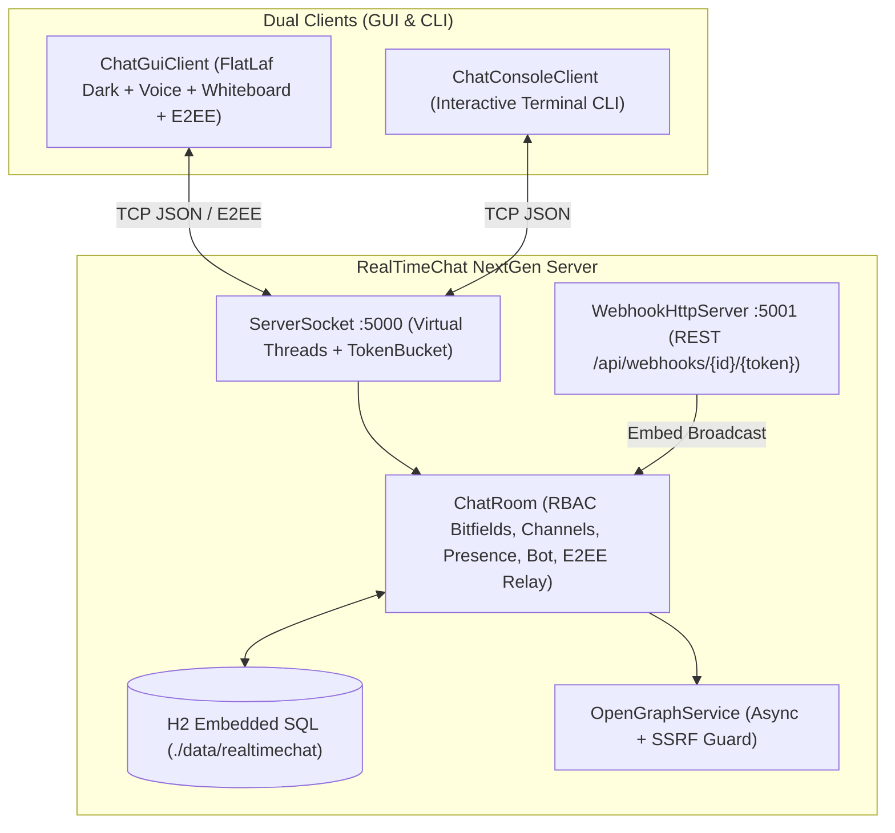

<p align="right">
  <strong>Language:</strong>
  <b>English</b> | <a href="README.es.md">Español</a>
</p>

# RealTimeChat NextGen v4.0

<p align="center">
  
  
  
  
  
  
  
  
  
</p>

**RealTimeChat NextGen v4.0** is a high-concurrency real-time communication and collaboration suite built in **Java 21 LTS** (Virtual Threads, FlatLaf Dark Swing GUI, H2 SQL persistence, embedded HTTP Webhook server, and TCP JSON sockets). It brings Discord-grade workflows including Optimistic UI, threads, live reactions, presence detection, cursor pagination, offline queuing/resync, bitfield permissions, Markdown + Piston code execution, slash commands, search filters, clipboard image paste, OpenGraph previews, PCM voice rooms, a collaborative whiteboard, and ECDH + AES-256-GCM end-to-end encrypted direct messages.

<p align="center">
  
</p>

---

## Key Features

### Phase 1: Real-Time Experience, Presence & Customization
- **Custom Uploadable & Resizable Avatars**: Upload local PNG/JPG/GIF/WebP photos, zoom/pan crop interactively inside `AvatarCropDialog`, preview circular avatars across chat messages, member sidebar, and profile cards.
- **Structured Profile Customization**: Multi-line biography editor enforced at `240` characters with live counter (`0/240`), vector avatar presets (`cyber-neon`, `synthwave`, `cosmic`, `emerald`, `sunset`, `bot-matrix`, `golden`, `retro-pixel`), and banner themes/hex colors.
- **Optimistic UI & Message Lifecycle**: Local `tempId` `SENDING` state with reduced opacity, real-time server `MESSAGE_ACK` assigning permanent DB `id` & `timestamp`, and red `ERROR` cards with Retry / Delete actions after 8s timeout.
- **Throttled Typing Indicators**: Client-side 2.5s emission throttle (`TYPING_START` / `TYPING_STOP`) and receiver 3.0s auto-debounce cleared immediately upon message delivery.
- **Nested Replies & Thread Side Panel**: Clickable quote previews (`replyToId`) jumping to parent messages, plus a dedicated Discord-style side drawer (`ThreadSidePanel`) scoped by `threadParentId`.
- **Advanced Presence System**: Automatic inactivity monitor (`IDLE`), notification suppression (`DND`), heartbeat offline tracking (`OFFLINE`), and custom status text/tag.
- **Delta Emoji Reactions**: Incremental `REACTION_ADD` / `REACTION_REMOVE` broadcasts updating grouped counters live.

### Phase 2: Scalability, Persistence & Access Control
- **H2 Embedded SQL Database**: Persistent tables (`user_profiles`, `channels`, `messages`, `webhooks`) replacing volatile RAM history.
- **Cursor-Based Pagination & Feed Virtualization**: `beforeId` / `afterId` keyset queries (no `OFFSET`) powering smooth upward infinite scroll without viewport jump and sliding-window card pruning.
- **Offline FIFO Queue & Reconnect Resync**: Automatic exponential-backoff reconnect (`autoReconnect`), local queuing of messages composed while disconnected, and automatic `afterId` gap filling upon reconnect.
- **Channel Lifecycle & Bitfield RBAC Permissions**: Create/delete text or voice channels dynamically with bitmask permissions (`VIEW_CHANNEL`, `SEND_MESSAGES`, `MANAGE_MESSAGES`, `ADMINISTRATOR`, `MANAGE_CHANNELS`, `MANAGE_ROLES`, `MANAGE_WEBHOOKS`, `CREATE_THREADS`, `VOICE_CONNECT`) and per-channel user overrides enforced on both server and client UI.

### Phase 3: Technical Tools, Commands & Search
- **Rich Markdown & Piston Code Runner**: Renders `**bold**`, `*italic*`, `` `inline` ``, `~~strike~~`, `@mentions`, auto-linked URLs, and fenced code blocks with Copy button and **Run >** execution against the Piston API (`stdout`/`stderr`).
- **Slash (`/`) Autocomplete Engine & Polls**: Live popup suggestions for `/poll Question | Opt1 | Opt2` (real-time vote tallies), `/roll [NdM]`, `/shrug`, `/clear`, `/join`, `/createchannel`, `/deletechannel`, `/search`, `/status`, `/w`, `/bio`, and `/whiteboard`.
- **Channel Webhooks (`POST /api/webhooks/{id}/{token}`)**: Embedded `com.sun.net.httpserver.HttpServer` (`tcpPort + 1`, default `5001`) accepting external JSON payloads and broadcasting rich embeds into channels, with `/api/health`.
- **Advanced Search with Modifiers**: Filter queries parsed via `from:user`, `in:#channel`, `has:link`, `has:file`, and keywords with click-to-jump navigation.

### Phase 4: Media, Collaboration & Security
- **Direct Clipboard Paste (`Ctrl+V`)**: Intercepts clipboard images, displays removable strip previews, scales/compresses via JPEG encoding (`ImageUtils`), and renders inline clickable lightboxes.
- **Async OpenGraph Previews**: Background metadata extraction (`og:title`, `og:description`, `og:image`, `og:site_name`) with SSRF private-IP/localhost filtering pushing `MESSAGE_EMBED_UPDATE` patches.
- **PCM Voice Channels & Collaborative Whiteboard**: Low-latency 16 kHz mono audio rooms (`javax.sound.sampled`) with RMS speaking indicators and Mute/Deafen controls, plus real-time synchronized drawing canvas (`WhiteboardDialog`) and `WEBRTC_SIGNAL` relay.
- **End-to-End Encrypted DMs (`E2EE`)**: Ephemeral/session **ECDH (`secp256r1`)** key exchange deriving **AES-256-GCM** secrets via SHA-256; private message ciphertext + `iv` remain opaque to the server and H2 database.

---

## Network Architecture



---

## Build & Execution

### Prerequisites
- **Java Development Kit (JDK) 21 LTS+**
- **Apache Maven 3.9+**

### Compile, Run Tests & Package Fat JAR
```bash
mvn clean test package
```
Produces shaded executable JAR at `target/realtimechat-1.0.0.jar` (`10.56 MB` with FlatLaf, Jackson, H2, and multi-resolution window icons).

### Run Server & Client
```bash
# Server (TCP :5000 + Webhook HTTP :5001 + ./data/realtimechat H2 DB)
java -cp target/realtimechat-1.0.0.jar com.danicaju.chat.server.ChatServer 5000

# Desktop GUI Client
java -jar target/realtimechat-1.0.0.jar

# Terminal CLI Client
java -cp target/realtimechat-1.0.0.jar com.danicaju.chat.client.ChatConsoleClient
```

### Docker Deployment
```bash
docker build -t realtimechat:latest .
docker run -d --name realtimechat-server -p 5000:5000 -p 5001:5001 realtimechat:latest
```

---

## Testing & Quality Assurance

Verified with **103 automated JUnit 5 tests** across 15 test suites:
- **`ChatRoomTest` (32)**: Concurrency, case-insensitive user checks, channel switching/creation/deletion, bitfield overrides, history bounds.
- **`MessageTest` (16)**: JSON roundtrip, forward compatibility, rich factory payloads.
- **`RealTimeBotTest` (14)**: Summarization, math parser (`^`, `sqrt`, precedence), diagnostics, computing topics.
- **`ChatServerIntegrationTest` (11)**: Live TCP handshakes, multi-channel isolation, typing events, rate limiter, reactive profiles.
- **`DatabaseManagerTest` (5)**: H2 persistence, keyset cursor pagination (`beforeId`/`afterId`), threads, reactions, webhooks, filtered search.
- **`PhaseOneToFourIntegrationTest` (4)**: Live TCP/HTTP tests covering Optimistic ACK, threads, reactions, DND presence, bitfield `SEND_MESSAGES` denial, polls, REST webhooks, offline FIFO queue & reconnect `afterId` resync, and ECDH+AES-GCM E2EE opaque storage.
- **`TokenBucketRateLimiterTest` (4)** & **`UserProfileTest` (4)**: Flooding defense and 240-char bio/profile validation.
- **`SlashCommandHelperTest` (3)**, **`ImageUtilsAndMarkdownTest` (2)**, **`OpenGraphServiceTest` (2)**, **`E2EECryptoTest` (2)**, **`PermissionTest` (2)**, **`PistonClientTest` (1)**, **`SearchQueryParserTest` (1)**.

```text
[INFO] Tests run: 103, Failures: 0, Errors: 0, Skipped: 0
[INFO] BUILD SUCCESS
```

---

<p align="center">
  <sub>Developed by <b>Daniel Casado Juan</b> | Universitat de les Illes Balears (UIB)</sub>
</p>
